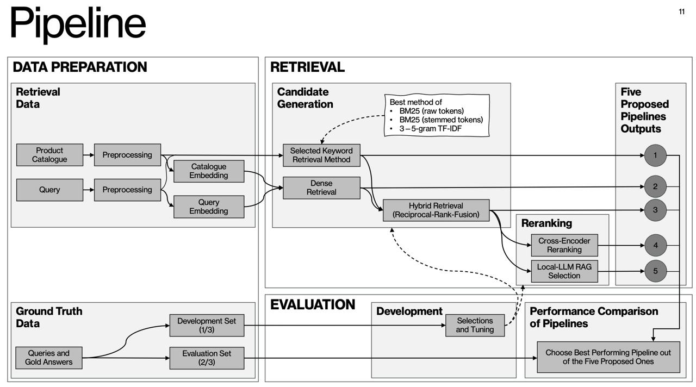

# Finnish Product Search for B2B Quotation Requests

**University of Oulu NLP course project**

You type a customer request line in Finnish, for example "kuusiokoloruuvi M8x40 A4", and the system returns a ranked list of matching products from a technical wholesaler's catalogue of about 74,000 products.

We compare five ways of doing this on real public requests for quotation (RFQs) and look at which one works best and where each one fails.

## The question

Which retrieval method finds the right product most often for a Finnish request? 

Does the answer change between standard products (DIN and ISO parts) and harder categories like hand tools, clothing and cutting tools?

Keyword search has trouble with Finnish inflection and compound words. Embedding search can lose exact codes and sizes. So we study the failures as closely as the overall score. If a plain keyword baseline matches or beats the fancier methods on short technical titles, that is a good result too.

## Data

There are two raw files. `catalog.csv` holds all the product data: name, code, product hierarchy, an HTML long description and a clean short text. Everything is in Finnish, and titles are short and full of codes and sizes like M8x40 or A4.

`rfq.xlsx` holds the test queries with their gold answers. The queries come from 10 to 15 public RFQs from cities, municipalities and other public bodies, about 150 to 200 request lines. We add 30 to 50 hand written queries for categories that are thin in the RFQs. For each line, the product the wholesaler actually offered is the gold answer. There are no prices or sensitive details.

The queries are split into a development set (one third) and an evaluation set (two thirds). The retrieval code never sees the gold answers.

## Pipeline



Product texts and queries get the same cleaning: HTML is removed and sizes are written in one form, so "M8X40", "m8 x 40" and "M8 x 40 mm" look the same. Then five pipelines run side by side:

| # | Pipeline | What it does |
|---|----------|--------------|
| 1 | Keyword | The best of three: BM25 on raw tokens, BM25 on stemmed tokens, or TF-IDF on 3 to 5 character n-grams |
| 2 | Dense | Embedding similarity only |
| 3 | Hybrid | Combines 1 and 2 with Reciprocal Rank Fusion |
| 4 | Hybrid + cross-encoder | Reranks the top 20 hybrid results with bge-reranker-v2-m3 |
| 5 | Hybrid + local LLM | Gives the top 20 hybrid results to a local 7B to 8B model, which picks one product code or answers "none" |

In pipeline 5 the model returns JSON with the chosen code and a short reason, and we check that the code is one of the candidates. The "none" answer lets the model say that nothing fits.

The development set is used for all choices and tuning: the keyword method, the fusion parameter, and the settings for reranking and the LLM prompt (the dashed arrows in the picture). The evaluation set is used once, at the end, to pick the best pipeline.

We report Hit@1 (the main number), Recall@5, Recall@10, MRR, query latency and indexing time, overall and per product category. McNemar's test checks whether Hit@1 differences are real, and bootstrap confidence intervals do the same for MRR. We then go through the failed top 1 results by hand and sort them into abbreviation errors, size or number mismatches, wrong category and acceptable substitutes.

## Why we chose these tools

We embed the Finnish text directly. Translating everything to English first would be one more step where codes and technical terms can get garbled, and the multilingual models we use read Finnish fine.

The embedding model is BGE-M3. It works with Finnish and fits on a 16 GB laptop. If it disappoints, Multilingual-E5-Base is the backup.

Vectors go into LanceDB. With 74,000 products a database server would be overkill, and LanceDB is just a folder on disk that can also filter by category and do text search.

SQLite covers a few small jobs: a cache so we don't embed the same text on every run, a log of all experiment results, and a second BM25 implementation (FTS5) to check our keyword numbers against.

## Demo

A Gradio app uses the same retrieval code as the evaluation. Type a product description and see the top five results from each method side by side, or upload an Excel RFQ and download the comparison matrix.

## Layout

```
data/         catalog.csv and rfq.xlsx (raw), cleaned versions
src/          cleaning, embeddings, retrievers, evaluation
notebooks/    data exploration and evaluation
docs/         pipeline picture
app.py        Gradio demo
```